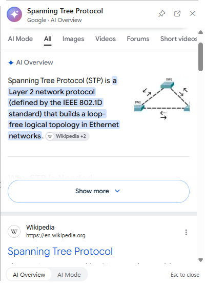

# MagicWand

Select text anywhere in Windows (PDFs, Word, Wikipedia, docs...) and a small glowing orb appears next
to it. Click it and a compact card opens right under your cursor with Google's AI Overview (phone
layout, your Windows language, light/dark theme). Switch to Google AI Mode in the card's footer.

Free, no account, no API key, no admin rights. Windows 10/11 with Windows PowerShell 5.1.

| Action | Result |
|---|---|
| Drag-select or double-click a word, then **click the orb** | Answer card under the cursor |
| **Right-click the orb** | Card opens in Google AI Mode |
| Copy text, then **click the tray icon** | Look up the clipboard (for apps where no orb shows) |
| Tray icon right-click | Pause / Quit |

The card closes with `Esc` or a click outside it; the pin keeps it open, drag it by its header,
resize it from its edges. The card only shows Google pages: result links open in your default browser.

## Install

1. Download the repository (Code > Download ZIP) and extract it.
2. **Unblock the files.** Windows blocks scripts downloaded from the internet. Right-click the ZIP
   before extracting > Properties > tick **Unblock**, or after extracting run in PowerShell:
   `Get-ChildItem -Recurse | Unblock-File` in the extracted folder.
3. Double-click `Install.cmd`. It copies the app to `%LOCALAPPDATA%\Programs\MagicWand`, starts it,
   and starts it with Windows (Startup folder shortcut). Uninstall: `Install.cmd /uninstall`.

To try it without installing: `Start MagicWand.cmd`.

## Privacy

- **The text you look up is sent to Google** as a search query, only when you click the orb (or the
  tray icon). Nothing is sent while you just select text. Don't use it on confidential documents.
- Clicking the orb copies the selection through the clipboard and then restores your previous
  clipboard; Windows clipboard history (Win+V) will still record the copied text.
- Google cookies and settings for the card live in `%LOCALAPPDATA%\MagicWand\WebView2`. Delete that
  folder to reset them. The app keeps no other data; errors (never the selected text) are logged to
  `%LOCALAPPDATA%\MagicWand\log.txt`.

## Antivirus / SmartScreen

MagicWand is an unsigned PowerShell script that compiles a small helper at startup, watches the mouse
and sends `Ctrl+C` to the active window. Some antivirus products flag that pattern. Everything it does
is in `MagicWand.ps1`; read it before running it.

## How it works / limits

- The orb shows when you drag or double-click while the mouse cursor is the text I-beam (or in
  apps listed in `$AnyDragApps`, e.g. Acrobat and Office, which use their own cursors).
- Clicking the orb sends `Ctrl+C` to the app (`Ctrl+Insert` in terminals) and reads the text.
- It can't read selections in apps running as administrator (Windows blocks input to them).
- Settings are at the top of `MagicWand.ps1` (orb timeout, optional "Ctrl+C twice" shortcut, off by
  default because DeepL uses it).
- `MagicWand.ps1 -Demo "some text"` opens a card at startup (for screenshots and tests).

## Third-party components

`lib\` contains the Microsoft WebView2 SDK 1.0.4258.31 (`Microsoft.Web.WebView2.Core.dll`,
`Microsoft.Web.WebView2.Wpf.dll`, `WebView2Loader.dll` x64), from the
[Microsoft.Web.WebView2](https://www.nuget.org/packages/Microsoft.Web.WebView2) NuGet package,
redistributed under `lib\WebView2-LICENSE.txt`. The browser engine itself is the WebView2 Runtime,
which ships with Windows 11 and updates through Windows Update. Update the SDK DLLs from time to time.

## License

[MIT](LICENSE)
